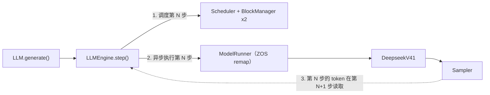
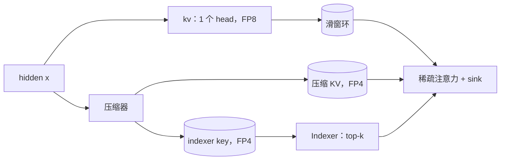

## 为什么要一个更小的 DeepInfer

[DeepInfer](https://github.com/deepseek-ai/DeepInfer) 在几十张 GPU 上服务 DeepSeek-V4.1-Flash，靠的是 C++ 调度器、EP/DP/CP 并行和定制 kernel。它是当下最值得研究的推理引擎之一，也是最难读的之一：设计决策分散在 C++、Python 和 TileLang 里，运行还需要 SM100 硬件。

[mini-DeepInfer](https://github.com/algebra-MCX/mini-DeepInfer) 尝试保留它最有特色的部分、去掉规模相关的部分。完整的 V4.1 架构可以用 6800 万参数的随机权重 checkpoint 在单张 GPU 上运行，真实的 V4.1-Flash 在 4 × B200 上运行，请求的每一步都能在普通 PyTorch 代码里跟踪和修改。

| 保留 | 去掉 |
| --- | --- |
| 分页 KV block + 每序列 state slot | C++ 调度器与 DP 组投票 |
| prefill / decode 分步、chunked prefill、抢占 | 上下文并行与多机通信 |
| 零开销调度（ZOS） | 大部分定制 kernel（改用 PyTorch / Triton） |
| 确定性、与 batch 无关的采样 | DSpark 投机解码、结构化输出（尚未实现） |
| 完整 V4.1 模型：压缩 KV、稀疏 indexer、hyper-connections、Engram、MoE | 图像输入 |

这个项目不是更快的 DeepInfer，而是一个每次状态转移都能读懂、能测试的版本。

## 写代码之前的四个承诺

[运行时设计文档](https://github.com/algebra-MCX/mini-DeepInfer/blob/main/docs/DEEPINFER_DESIGN.md)先于实现写成。它定下四个可观察的承诺，之后的每项优化都必须守住：

1. **每个 step 都有明确的输入和输出。** 调度输出描述本轮 token 数、序列顺序、block table 和需要采样的行；设备执行不会背着 CPU 修改队列。
2. **资源生命周期可以被证明。** KV block 和 V4.1 state slot 各自只有一个所有者；抢占、完成、取消都会同时释放两者。
3. **重算是等价的。** 采样随机性只取决于序列 seed 和 token 位置，不依赖 batch 行号，也不依赖全局 RNG 的历史。
4. **每条性能路径都有回归证据。** 先用小测试暴露状态差异；基准测试必须记录硬件、checkpoint、batch、上下文、dtype 和 warm-up。

这四条比搬运全部生产特性更重要。EP、CP 和定制 kernel 以后都可以替换进来，边界不能破。

## Step 的数据契约

一次引擎迭代分三部分。开启 ZOS 时，第 N 步的 CPU 工作与第 N−1 步的 GPU 工作重叠：

```text
第 N 步（enable_zos=True）
  CPU  schedule(N)        只依据预定状态决策（已缓存 / 在途 token 数）
  CPU  execute(N)         异步提交输入、forward、采样和回拷；仍在 GPU 上的在途 token
                          从第 N-1 步的输出缓冲中读取（remap）
  CPU  process(N-1)       等待第 N-1 步完成，追加 token，结束并释放序列
  GPU  ... 第 N-1 步 ... | ... 第 N 步 ...
```



ZOS 下同一条序列有两个长度：CPU 知道 `len(token_ids)`，GPU 已预留 `get_len() = len(token_ids) + num_inflight_tokens`。只有 `num_cached_tokens == get_len() - 1` 时 decode 才合法。调度时先增加 reservation，结果返回时才追加真实 token。如果结果携带的 `epoch` 已经失效（这期间序列被抢占或取消），就丢弃它，不写回序列。

唯一允许读取 GPU 结果的地方是 `StepHandle.wait()`。这里的"重叠"描述的是依赖结构；只有 forward 本身不含 host 同步时，重叠才真正发生，所以去掉这些同步是单独的一个里程碑。

## 两类注意力状态

V4.1 的缓存不是一张 KV 表，而是生命周期不同的两类状态，调度器同时分配两者：

| 状态 | 存放位置 | 写入者 |
| --- | --- | --- |
| 压缩 KV、indexer 的 key | 分页 KV block，每块 128 个 token | KV 源层，每 `ratio` 个 token 一项 |
| 滑窗环形缓冲、压缩器尾部 | 每条序列一个 state slot | 每一层 / KV 源层 |

在单个注意力层内部，滑窗环保存最近 128 个位置；压缩器每 `ratio` 个 token 池化一次，写出 FP4 的压缩 KV 和 indexer key；indexer 再为稀疏注意力选出 top-k 个压缩条目：



只有 KV 源层运行压缩器，只有 index 源层运行 indexer；中间的层读取源层的缓存，并复用它的 top-k 选择。

直接后果是：释放必须成对发生。

```python
block_manager.free(seq.block_table)
state_manager.free([seq.state_slot])
```

只释放 block，调度器会看到空闲 KV，下一条请求却会在 state slot 上泄漏。

## 调度、抢占与取消

Prefill 保持 waiting 队列 FCFS；队头 prompt 放不下时就停止尝试，不越过它，避免不可预测的饥饿。`max_num_batched_tokens` 只限制本轮的 query token，所以 chunked prefill 允许一个 prompt 跨多个 step，只有最后一块才预留采样。

Decode 让每条 running 序列前进一个 token。block 不足时，抢占输出最长的序列，把它放回 waiting 队列头。抢占会递增 epoch，旧的 GPU 结果因此不会污染重算。

取消是显式的终态，不是伪装的 EOS：

1. 让在途的 `StepHandle` 完成；
2. 在调度器里使请求的 epoch 失效；
3. 从 waiting / running 队列中移除；
4. 同时释放 block 和 state slot；
5. 返回 `abort` 结束原因。

这个顺序保证 GPU 还在读取某个 block 时，它不会被提前复用。

## 确定性采样

抢占会重算序列，所以重算出的 token 必须和丢弃的完全一致。采样器使用 Gumbel-max，噪声只由序列和位置决定：

```text
sample_seed = mix_seed(sequence_seed, output_position)   # SplitMix64 风格的哈希
token       = argmax(logits / temperature + Gumbel(sample_seed))
```

噪声由 Triton kernel 内的 Philox 生成，因此一行的采样结果只取决于它自己的 logits、seed 和位置。测试覆盖：单行与多行 batch 一致、正序与逆序 batch 一致、抢占重算后 token 一致、取消一个请求不改变其他请求。

## 40 行实现 EP × DP

每张卡跑自己的调度器和 batch；注意力和稠密层每卡复制一份。路由专家按卡均分，Engram 表按行切分。切分的层先汇总所有 rank 的 token，只用本卡的分片计算，再把部分和 reduce-scatter 回去：

```python
def all_gather_rows(x):
    n = torch.tensor([x.size(0)], device=x.device)
    dist.all_reduce(n, op=dist.ReduceOp.MAX)          # 每个 rank 补齐到最大 batch
    ...
    dist.all_gather_into_tensor(out, x.contiguous())
    return out

def reduce_scatter_rows(y, num_rows):
    out = y.new_empty(y.size(0) // world()[0], *y.shape[1:])
    dist.reduce_scatter_tensor(out, y.contiguous())   # 每个 rank 拿到自己 token 的求和结果
    return out[:num_rows]
```

这就是整个并行层（[`parallel.py`](https://github.com/algebra-MCX/mini-DeepInfer/blob/main/minideepinfer/models/deepseek_v41/parallel.py)，38 行）。单进程时这些函数都是空操作，所以同一份模型代码既能跑一张卡，也能跑四张卡。

## 对照官方参考实现

`tests/test_v41.py` 在相同权重上运行 DeepSeek 官方参考实现（`inference/model.py`，随 V4.1-Flash checkpoint 发布）：

| 检查项 | 结果 |
| --- | --- |
| FP8 / FP4 fake quant 对比官方 TileLang kernel | 逐位一致 |
| 两级候选块筛选 | 逐位一致 |
| Sinkhorn 混合、稀疏注意力对比官方 kernel | bf16 误差范围内一致 |
| 引擎端到端：4 个 prompt（37–520 token）同批；ZOS 开 / 关；chunked prefill 128 和 200；抢占 | 每一步 logits 与官方差距小于 0.05（实测最大约 0.02）；greedy token 一致 |

token 比较到官方自身 top-2 差距小于容差的那一步为止：随机权重的 logits 很平，近似平局之后两边比较的只是噪声。CPU CI 只跑不依赖 CUDA 的检查；没有 GPU 时 GPU 测试显示为 skipped，这不代表通过。

## 接下来读什么

每个模块都对应 DeepInfer 中的一个位置：

| mini-DeepInfer | DeepInfer 对应位置 |
| --- | --- |
| `engine/block_manager.py` | `csrc/engine/block_manager.hpp` |
| `engine/scheduler.py` | `csrc/engine/scheduler.hpp`（`_schedule_prefill`、`_schedule_decode`） |
| `engine/llm_engine.py` | `deepinfer/engine/llm_engine.py`（`step`） |
| `worker/model_runner.py` | `deepinfer/worker/worker.py`（`execute_model_step`）、`csrc/engine/zos.cpp` |
| `layers/sampler.py` | `tilelang_ops/random_sampling.py` |
| `models/deepseek_v41/` | DeepSeek 的 `inference/model.py`，改写为分页、批处理执行 |
| `bench_prefill.py` | `examples/benchmark.py` + `examples/sweep/run_sweep.sh prefill` |

运行方式：

```bash
git clone https://github.com/algebra-MCX/mini-DeepInfer.git
cd mini-DeepInfer
uv run examples/offline_inference.py   # 任意 8 GB 显存的 CUDA GPU；随机权重，输出文本没有意义
```

这个项目不声称的内容：单卡 PyTorch 实现不等于官方多卡吞吐；随机权重 checkpoint 只能验证执行语义，不能证明模型能力；在有 grammar 编译器和接受率轨迹之前，结构化输出和 DSpark 都不算支持。真实模型的 prefill 路径离 DeepInfer 还有多远、三个 kernel 如何缩小了一部分差距，见[下一篇](/writing/mini-deepinfer-prefill/)。
