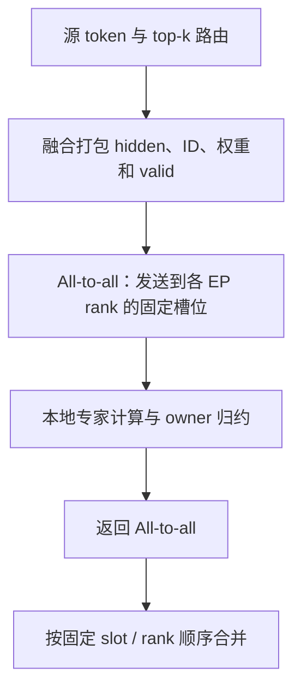

## 要回答的问题

小批量 decode 中，准备和搬运专家输入的耗时可能比实际 GEMM 更显著。固定容量布局省去动态 counts 交换和主机回读，却会传输填充行。融合 kernel 的收益能抵消这些额外搬运吗？

我把 MoEFlow 实现为 vLLM 插件，在两次 NCCL all-to-all 前后融合 dispatch pack、专家输入准备和确定性 combine，模型加载仍由 vLLM 负责。本文分析的是 [2026 年 11 月 22 日核对的公开源码快照](https://github.com/algebra-MCX/MoEFlow/tree/2f4968ffef7cac4f8dcf39a4a65cec55c60472f8)。下列数值来自作者已记录的实验，本次博客改造没有重跑 GPU 基准。

## 沿着一个 token 看执行

一个 token 携带 hidden states、top-k 专家 ID、FP32 权重和 valid 标记。把这些信息打包进一行，可以避免单独交换 counts。每个目标 rank 都接收该源 token 的固定槽位，只计算本地专家，再把部分输出传回源 rank，按确定顺序合并。

静态形状让路径可以捕获为 CUDA Graph。代价也很具体：dispatch 发送 **EP × C 行**，而非仅发送实际命中行。例如 EP4、容量 C=1 时，每个源 token 为四个目标各预留一个槽位；这只是布局示例，不预测延迟。实现见 [`fixed.py`](https://github.com/algebra-MCX/MoEFlow/blob/2f4968ffef7cac4f8dcf39a4a65cec55c60472f8/moeflow/fixed.py)，独立参考见 [`reference.py`](https://github.com/algebra-MCX/MoEFlow/blob/2f4968ffef7cac4f8dcf39a4a65cec55c60472f8/moeflow/reference.py)。

## 实验测了什么

| 条件 | 记录的设置 |
| --- | --- |
| 硬件 | 4 × B200，NVLink-5，EP4 |
| 层 | GLM-5.3-Flash 第 3 层，BF16，均匀路由 |
| 计时边界 | router logits 到加权路由专家输出；不含 gate GEMM、共享专家、norm 与 residual |
| 执行 | CUDA Graph replay；每样本取四个 rank 中最慢者 |
| 对比 | 20 次交替 A/B；配对差的 95% 置信区间不跨零才计为收益 |
| 正确性关卡 | 每个测量点前先与独立的逐 token、逐专家参考对比 |

仓库列出的环境是 vLLM 0.32.0、Torch 2.13 / CUDA 13、Triton 3.7.1、NCCL 2.29.7。当前快照没有附历史运行的原始 JSON，因此这是文档中的环境，不能当作逐次试验已独立核验的版本清单。

## 融合改善了自身基线

| 每 rank token 数 | 自身未融合 Torch Ring（µs） | 融合后（µs） | 降幅 |
| --- | ---: | ---: | ---: |
| 1 | 249.7 | 144.2 | 42.3% |
| 8 | 574.9 | 461.7 | 19.7% |
| 128 | 873.9 | 740.8 | 15.2% |

这组实验比较的是 MoEFlow 内部实现开销。最小 batch 的相对收益最大，但它还不能回答该执行策略是否优于另一个后端。

## 原生 vLLM 仍是更强的基线

**另一轮独立运行**在相同 router 与专家 GEMM 下，对比原生 all-gather/reduce-scatter：

| 每 rank token 数 | 原生 vLLM（µs） | MoEFlow（µs） | MoEFlow 延迟变化 |
| --- | ---: | ---: | ---: |
| 1 | 140.9 | 146.5 | +3.9% |
| 8 | 451.3 | 464.9 | +3.0% |
| 128 | 742.3 | 752.7 | +1.4% |

八个已记录尺寸上，MoEFlow 仍慢 1.4–4.7%。两张表来自不同运行，不能跨表直接相减。完整 FP8 模型服务测试使用 1024 输入 / 1024 输出 token、并发 4；两次结果方向相反，原生基线自身 TPOT 在两次运行间相差 11.6%。因此没有证据支持稳定的服务级加速。

## 先检查实现，再复现

- [测量表与局限](https://github.com/algebra-MCX/MoEFlow/blob/2f4968ffef7cac4f8dcf39a4a65cec55c60472f8/README.md#performance)
- [交替运行的融合测量作业](https://github.com/algebra-MCX/MoEFlow/blob/2f4968ffef7cac4f8dcf39a4a65cec55c60472f8/scripts/paired_total_fusion.sbatch)
- [原生与固定容量路径的对照作业](https://github.com/algebra-MCX/MoEFlow/blob/2f4968ffef7cac4f8dcf39a4a65cec55c60472f8/scripts/paired_native_fixed.sbatch)
- [计时、统计与验证代码](https://github.com/algebra-MCX/MoEFlow/tree/2f4968ffef7cac4f8dcf39a4a65cec55c60472f8/scripts/bench)
- [Graph 检查与 CPU 参考测试](https://github.com/algebra-MCX/MoEFlow/tree/2f4968ffef7cac4f8dcf39a4a65cec55c60472f8/tests)

脚本可以查看，但当前公开快照没有原始配对样本和环境清单。可以独立检查源码；要复现文中那个精确测量点，仍需要补齐材料并使用匹配的 GPU。

## 什么观测会改变结论？

我的判断是，融合减少了固定容量后端内部的调度开销。要让这部分节省传到服务端，它得处于请求的关键路径上，而且不能被填充、通信或其他环节抵消。可分两步检验：先用相同输入形状和图重放策略对比融合前后，再固定请求轨迹、模型、并发和输出长度，对照原生 vLLM。分别测均匀与偏斜路由，记录有效行、预留行、各 rank 耗时与端到端延迟。如果层级收益仍在，而服务延迟变化没有超过重复运行的波动，就不能对该负载声称服务加速。

## 仍待回答的问题

EP8、并发正确性、长 prefill 性能以及与 DeepEP HT 的端到端对比尚未验证。README 还记录了 8192 token 的 exact-score 检查仍失败。后续应先解决该正确性问题，保留每轮原始 JSON，再重复原生与完整模型对照，之后才有条件讨论服务收益。

值得继续追问的是：填充、通信和准备操作分别如何进入关键路径？融合节省耗时说明了具体实现的问题；端到端策略仍需要自己的实验。
