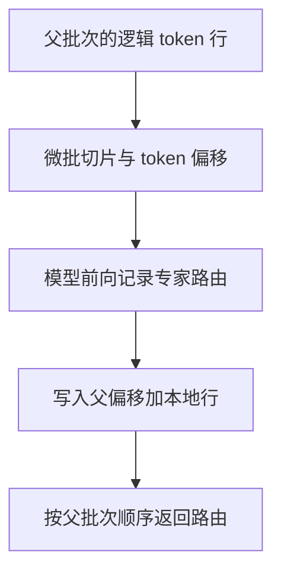

## 看得见的故障

MRV2 同时启用 DBO 和 `--enable-return-routed-experts` 后，返回的专家路由记录出现损坏。原因是每个微批都从共享 capture buffer 的第 0 行开始写，最后一个微批覆盖了前面的记录。

我在 [vLLM #63372](https://github.com/vllm-project/vllm/pull/63372) 中复现并修复了这个问题，2026 年 10 月 25 日合并。Ronald1995 参与重构，复用已有 DBO token offset，并补充测试。这是一项已合并的正确性贡献，不是服务性能提升的结论。

## 沿着一行数据进入共享缓冲区

用一个四 token 的父批次举例，拆成两个各含两行的微批。第二个微批的本地第 0 行，应写入父批次第 2 行，而不是父批次第 0 行。

| 微批 | 本地行 | 原目标行 | 正确目标行 |
| --- | --- | --- | --- |
| 0 | 0、1 | 0、1 | 0、1 |
| 1 | 0、1 | 0、1，覆盖前者 | 2、3 |

修复将 `token_slice.start` 传入微批上下文，写入时使用 `dbo_current_ubatch_token_offset()`；非 DBO 下偏移为 0。这个例子解释行归属，回归测试和补丁则验证具体实现。



## 证据与适用边界

上游 PR 记录了同样的 32 个请求，模型为 DeepSeek-V2-Lite，2 × H200、DP2、EP、NIXL EP、eager 执行：

| 与关闭 DBO 的服务器对比 | 路由一致率 |
| --- | ---: |
| DBO 开启，原始 main | 0% |
| DBO 开启，应用修复 | 89.4% |
| DBO 关闭，重跑作为噪声对照 | 88–91% |

修复后恢复到了重复运行的对照区间。它**不证明**不同非确定性模型运行的路由严格相等，也不是模型质量分数。这组模型对照在协作者重构之前完成。

新增单测在原基线上 8/8 项不匹配，修复后通过。PR 记录重构前 H200 上已有 capture/ubatch 测试共 81 项通过；重构后重新运行了四个 capture 场景、重叠与单批等价测试以及 CUDA Graph replay 测试。具体代码与测试名称见[补丁和验证记录](https://github.com/vllm-project/vllm/pull/63372/files)。

## 另一个修复：保留最先记录的异常

相关排障问题是微批 1 先失败，微批 0 随后触发次生错误，而 `min(errors)` 选择了编号较小的微批 0，掩盖原始原因。[#63476](https://github.com/vllm-project/vllm/pull/63476) 也已合并，在线程全部 join 后返回最先记录的失败。

1 × H200、基线 `7822663cb4` 加新增用例时，结果是 1 失败、1 通过；修复后 2 项均通过。测试命令：

```bash
VLLM_USE_V2_MODEL_RUNNER=1 pytest -q \
  "tests/v1/worker/test_gpu_ubatch_slicing.py::test_ubatch_runner_names_the_microbatch_that_failed"
```

“最先记录”指 Python 中最先记录的异常。CUDA 错误异步上报，它未必等于最早发生的 GPU 故障。这项修改不解决 peer 退出导致的挂起，也不覆盖全部 HiSparse/DBO 问题。

## 继续核验

- [已合并的路由修复、审阅与共同作者记录](https://github.com/vllm-project/vllm/pull/63372)
- [已合并的异常顺序修复与回归证据](https://github.com/vllm-project/vllm/pull/63476)
- [独立的 decode staging 提案](/writing/vllm-decode-staging/)：更广的布局变动，仍在审阅中

共同的执行约定是：微批内部位置不等于逻辑请求位置。输出、路由、位置和异常记录的每个消费者，都需要明确的映射。新后端和更多微批数量仍要单独验证，不能由这两项修复推出所有配置都正确。

上游状态与 PR 文本核对日期：2026 年 11 月 22 日。本文没有重跑 GPU 测试。
