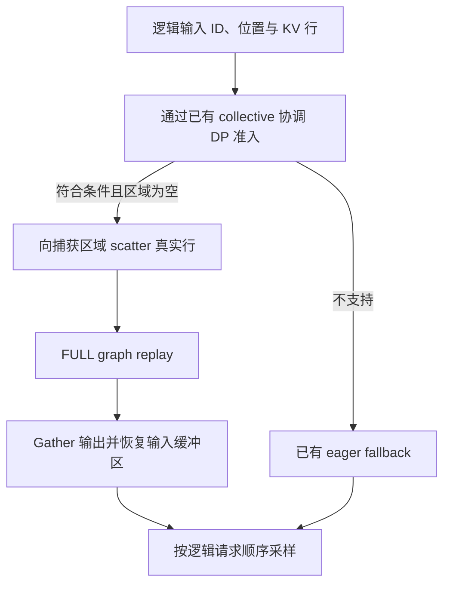

## 提案与当前状态

我提交的 [vLLM #63556](https://github.com/vllm-project/vllm/pull/63556) 尝试在不均衡 DP 负载导致捕获区域为空时，让符合条件的单 token MLA decode 保留 FULL 微批图执行。截至 2026 年 11 月 22 日，PR 仍开放。此前关闭的原型不属于已合并贡献。

## 一步具体的 decode

两个 rank 的负载是 **63 与 97 行**，选择图 bucket **128**，捕获区域为 `[0,64)` 和 `[64,128)`。较小 rank 连续放置 63 行，第二个区域为空，原策略让整个组回退到 eager。

Staging 把较小 rank 的 32 个真实行放到 `[0,32)`，另外 31 行放到 `[64,95)`。前向执行后，必须把 hidden states **以及输入缓冲区**都恢复到逻辑顺序，再执行采样。

Bucket 选择很关键。默认密集 bucket **104** 的切分点为 52，63/97 已能覆盖两个区域。因此这个定向例子不能预测真实流量里的激活频率。而 40/97 在 bucket 104 下仍可能留下空区域。

## 实现必须满足的约定

- Scatter 时保持 token ID、position、block table 和 KV slot 对应。
- 修改输入之前先检查容量，填充位置的 KV slot 保持 `-1`。
- 保持图地址和后端 metadata 约定。
- 同时恢复输出与输入，仅恢复 hidden states 不够。
- 不支持的路径继续使用 eager fallback。

支持范围包括默认 model state、NIXL EP、`FLASH_ATTN_MLA`、BF16 权重与 KV、TP1、单 token decode。返回路由、prompt embeddings、EPLB、KV transfer 仍回退。临时缓冲区与 scatter/gather/恢复写入都有成本，仍需 profile 隔离。

## 每条证据都要跟随它的版本

PR 中几类证据不能拼成一个“当前版本加速比”：

| 记录 | 能支持什么 | 不能支持什么 |
| --- | --- | --- |
| 历史定向 A/B | 某个泛化实现把指定负载的 fallback 换成 replay | 精确工作树 patch/hash 链及原始 trial 目录已不保留 |
| 较早 DP8 原型 | 执行路径与请求完成情况 | 原型省略输入恢复，后来发现与位置有关的采样缺陷 |
| 指定 head 模型回归（`b6660643fb`） | 每侧 160 请求，观测到预期 FULL128 replay，仓库比较器通过 | 8/160 贪心序列分歧，靠 mutual-top-5 规则接受；不是 token/logprob 严格相等 |
| 独立 ShareGPT 运行 | 默认 bucket、正常路由下完成 9,216 请求 | Staging 激活为零，不能推出激活路径的性能收益 |

历史数值保留在[上游验证章节](https://github.com/vllm-project/vllm/pull/63556)。由于版本追溯的局限，不适合作为当前实现的首页性能结论。下一步应对不可变、完整恢复输入的实现重复配对测量，记录激活次数，并明确输出比较规则。

## 什么结果会改变判断？

若真实负载很少触发 staging，它在服务中的价值就较小。若位置相关采样错误，速度再快也不成立。计入完整恢复开销的重复测量，也可能让收益缩小。这些都是可以检验的反对意见。

建议从[当前补丁](https://github.com/vllm-project/vllm/pull/63556/files)、回归测试与支持范围开始核验。[已合并的行归属修复](/writing/vllm-dbo-correctness/)解决的是更窄的正确性问题，不能替本提案背书。
