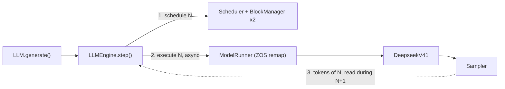
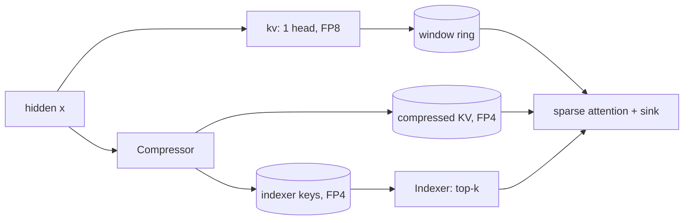

## Why a smaller DeepInfer

[DeepInfer](https://github.com/deepseek-ai/DeepInfer) serves DeepSeek-V4.1-Flash on dozens of GPUs with a C++ scheduler, EP/DP/CP parallelism and custom kernels. It is the most interesting inference engine to study right now, and also one of the hardest to read: the design decisions are spread across C++, Python and TileLang, and running it needs SM100 hardware.

[mini-DeepInfer](https://github.com/algebra-MCX/mini-DeepInfer) is my attempt to keep what makes it distinctive and drop the scale. The full V4.1 architecture runs on a single GPU with a 68M-parameter random-weight checkpoint, the real V4.1-Flash runs on 4 × B200, and every step of a request can be followed and changed in plain PyTorch.

| Kept | Dropped |
| --- | --- |
| Paged KV blocks + per-sequence state slots | C++ scheduler and DP-group voting |
| Separate prefill / decode steps, chunked prefill, preemption | Context parallelism and multi-node communication |
| Zero-overhead scheduling (ZOS) | Most custom kernels (replaced by PyTorch / Triton) |
| Deterministic, batch-invariant sampling | DSpark speculative decoding, structured output (not yet) |
| The full V4.1 model: compressed KV, sparse indexer, hyper-connections, Engram, MoE | Image input |

The project is not a faster DeepInfer. It is a version whose every state transition can be read and tested.

## Four promises before any code

The [runtime design document](/writing/mini-deepinfer-design/) was written before the implementation. It fixes four observable promises, and every later optimization has to keep them:

1. **Every step has an explicit input and output.** The scheduler's output describes the token counts, sequence order, block tables and rows to sample. Device execution never changes CPU queues behind its back.
2. **Resource lifetimes are provable.** KV blocks and V4.1 state slots each have exactly one owner; preemption, completion and cancellation release both.
3. **Recomputation is equivalent.** Sampling randomness depends only on the sequence seed and the token position, never on the batch row or the history of a global RNG.
4. **Every performance path has regression evidence.** A small test exposes the state difference first; a benchmark records hardware, checkpoint, batch, context, dtype and warm-up.

These matter more than porting every production feature. EP, CP and custom kernels can be swapped in later; the boundaries cannot be broken.

## The step contract

One engine iteration has three parts, and with ZOS enabled the CPU work of step N overlaps the GPU work of step N−1:

```text
step N (enable_zos=True)
  CPU  schedule(N)        decisions use reservations only (cached / in-flight token counts)
  CPU  execute(N)         enqueue inputs, forward, sampling and copy-back; an in-flight input
                          token is gathered on the GPU from step N-1's output buffer (remap)
  CPU  process(N-1)       wait for step N-1, append tokens, finish and free sequences
  GPU  ... step N-1 ... | ... step N ...
```



Under ZOS a sequence has two lengths. The CPU knows `len(token_ids)`; the GPU has reserved `get_len() = len(token_ids) + num_inflight_tokens`. Decode is legal only when `num_cached_tokens == get_len() - 1`. The scheduler adds a reservation when it schedules, and the real token is appended only when the result returns. A result carrying a stale `epoch` — from a sequence that was preempted or cancelled in the meantime — is discarded instead of written back.

The only place that may read a GPU result is `StepHandle.wait()`. Overlap here describes a dependency structure; it is only real once the forward pass itself contains no host synchronization, which is why removing those synchronizations was its own milestone.

## Two kinds of attention state

V4.1's cache is not a single KV table. It has two kinds of state with different lifetimes, and the scheduler allocates both:

| State | Lives in | Written by |
| --- | --- | --- |
| Compressed KV, indexer keys | Paged KV blocks, 128 tokens each | KV-source layers, one entry per `ratio` tokens |
| Sliding-window ring, compressor tail | One state slot per sequence | Every layer / KV-source layers |

Inside one attention layer, the window ring holds the last 128 positions, a compressor pools every `ratio` tokens into FP4 compressed KV and indexer keys, and an indexer picks the top-k compressed entries for sparse attention:



Only KV-source layers run a compressor and only index-source layers run an indexer; the layers in between read the source's cache and reuse its top-k choice.

The practical consequence is that release must happen in pairs:

```python
block_manager.free(seq.block_table)
state_manager.free([seq.state_slot])
```

Free only the blocks and the scheduler sees spare KV while the next request leaks a state slot.

## Scheduling, preemption and cancellation

Prefill keeps the waiting queue FCFS and stops at a head-of-line prompt that does not fit, rather than skipping it and creating unpredictable starvation. `max_num_batched_tokens` limits only the query tokens of a step, so chunked prefill lets a prompt span several steps, and only its last chunk reserves a sample.

Decode advances each running sequence by one token. When blocks run out, the sequence with the longest output is preempted and returned to the head of the waiting queue. Preemption increments its epoch, so an old GPU result can no longer contaminate the recomputation.

Cancellation is an explicit terminal state, not a disguised EOS:

1. Let the in-flight `StepHandle` finish.
2. Invalidate the request's epoch in the scheduler.
3. Remove it from the waiting/running queues.
4. Free its blocks and its state slot together.
5. Return the `abort` finish reason.

This order prevents a block from being reused while the GPU is still reading it.

## Deterministic sampling

Preemption recomputes a sequence, so the recomputed token must be exactly the discarded one. The sampler uses the Gumbel-max trick with noise keyed only on the sequence and its position:

```text
sample_seed = mix_seed(sequence_seed, output_position)   # SplitMix64-style hash
token       = argmax(logits / temperature + Gumbel(sample_seed))
```

Philox generates the noise inside a Triton kernel, so a row's sample depends only on its own logits, seed and position. The tests check that one-row and multi-row batches agree, that forward and reversed batch orders agree, that recomputation after preemption reproduces the tokens, and that cancelling one request leaves the others unchanged.

## EP × DP in 40 lines

Every GPU runs its own scheduler and batch; attention and dense layers are replicated. Routed experts are split evenly across GPUs and the Engram tables by rows. A sharded layer gathers the tokens of every rank, applies its local shard and reduce-scatters the partial sums back:

```python
def all_gather_rows(x):
    n = torch.tensor([x.size(0)], device=x.device)
    dist.all_reduce(n, op=dist.ReduceOp.MAX)          # pad every rank to the largest batch
    ...
    dist.all_gather_into_tensor(out, x.contiguous())
    return out

def reduce_scatter_rows(y, num_rows):
    out = y.new_empty(y.size(0) // world()[0], *y.shape[1:])
    dist.reduce_scatter_tensor(out, y.contiguous())   # each rank receives its tokens' sum
    return out[:num_rows]
```

That is the whole parallel layer ([`parallel.py`](https://github.com/algebra-MCX/mini-DeepInfer/blob/main/minideepinfer/models/deepseek_v41/parallel.py), 38 lines). In a single process every helper is a no-op, so the same model code runs on one GPU and on four.

## Correctness against the official reference

`tests/test_v41.py` runs DeepSeek's official reference implementation (`inference/model.py`, shipped with the V4.1-Flash checkpoint) on the same weights:

| Check | Result |
| --- | --- |
| FP8 / FP4 fake quant vs. the official TileLang kernels | Bit-exact |
| Two-level candidate block selection | Bit-exact |
| Sinkhorn mixing and sparse attention vs. the official kernels | Match within bf16 tolerance |
| Engine end to end: 4 prompts (37–520 tokens) in one batch; ZOS on / off; chunked prefill 128 and 200; preemption | Logits within 0.05 of the reference at every step (~0.02 max observed); greedy tokens identical |

Tokens are compared up to the first step where the reference's own top-2 margin is within tolerance. Random-weight logits are flat, and past a near tie both sides compare noise. The CPU CI runs only the CUDA-free checks; without a GPU, the GPU tests show as skipped, which is not a pass.

## Where to read next

Each module maps to a place in DeepInfer:

| mini-DeepInfer | DeepInfer |
| --- | --- |
| `engine/block_manager.py` | `csrc/engine/block_manager.hpp` |
| `engine/scheduler.py` | `csrc/engine/scheduler.hpp` (`_schedule_prefill`, `_schedule_decode`) |
| `engine/llm_engine.py` | `deepinfer/engine/llm_engine.py` (`step`) |
| `worker/model_runner.py` | `deepinfer/worker/worker.py` (`execute_model_step`), `csrc/engine/zos.cpp` |
| `layers/sampler.py` | `tilelang_ops/random_sampling.py` |
| `models/deepseek_v41/` | DeepSeek's `inference/model.py`, rewritten for paged, batched execution |
| `bench_prefill.py` | `examples/benchmark.py` + `examples/sweep/run_sweep.sh prefill` |

The [technical notes](/writing/mini-deepinfer-technical-notes/) walk through the same code module by module. To run it:

```bash
git clone https://github.com/algebra-MCX/mini-DeepInfer.git
cd mini-DeepInfer
uv run examples/offline_inference.py   # any CUDA GPU with 8 GB; random weights, meaningless text
```

What the project does not claim: a single-GPU PyTorch implementation is not official multi-GPU throughput, a random-weight checkpoint verifies execution semantics but not model quality, and structured output and DSpark are not supported until a grammar compiler and acceptance traces exist. How far the real-model prefill path is from DeepInfer — and how three kernels closed part of that gap — is the [next article](/writing/mini-deepinfer-prefill/).
