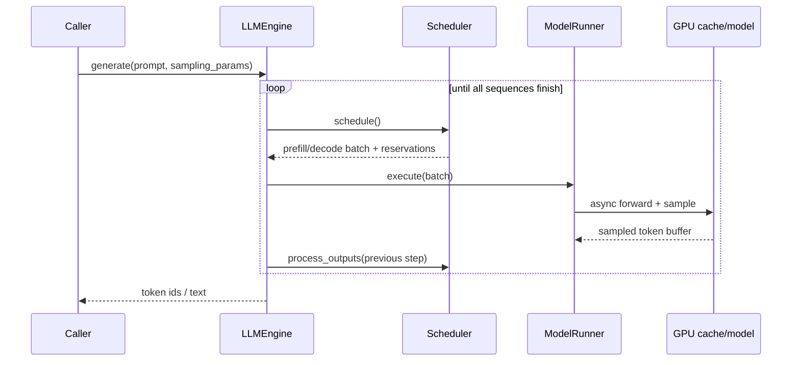
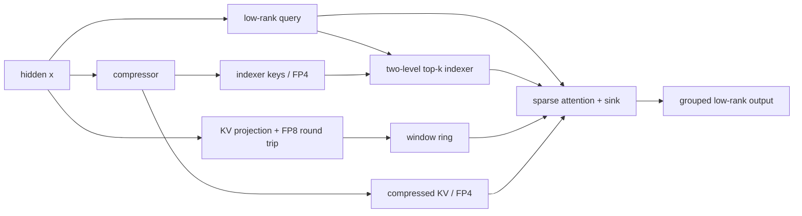

This document explains how mini-DeepInfer turns one request into a reproducible V4.1 inference step. It follows the current repository code and focuses on implementation boundaries that can be read, verified and changed; it is not a promise about DeepInfer's production-cluster performance. Read [A DeepInfer-Style Runtime Design](/writing/mini-deepinfer-design/) first for the mapping to the official design, the step data contract and the implementation order, then follow the tour below.

## 1. Scope and operating boundary

mini-DeepInfer is a PyTorch-first teaching runtime that supports a single GPU and intra-node EP × DP. It contains:

- DeepSeek-V4.1's compressed KV, sliding window, two-level sparse indexer, hyper-connections, Engram and MoE;
- DeepInfer-style paged KV blocks, per-sequence state slots, continuous batching, chunked prefill, preemption and deterministic sampling;
- component-level and end-to-end comparison tests against the official V4.1 reference.

It does not replicate the production C++ scheduler, CP and multi-node communication, the official custom CUDA/TileLang kernels, or the DSpark/MTP serving path. The default checkpoint is a small random-weight model: good for testing shapes and execution semantics, useless for judging generation quality.

## 2. The lifecycle of a request

The entry point is `minideepinfer/entrypoints/llm.py`. `LLM.generate()` creates a `Sequence` for each prompt and hands it to `LLMEngine`; every `step()` goes through three phases:

1. `Scheduler.schedule()` decides on the CPU whether this step is prefill or decode, and reserves KV blocks and state slots for the sequences;
2. `ModelRunner.execute()` sends the batch, block tables, positions and sampling parameters to the GPU asynchronously;
3. `Scheduler.process_outputs()` commits tokens once the results are readable, handles EOS/stop tokens/length limits, and releases finished or preempted state.
   Explicit cancellation goes through `LLMEngine.abort_request()`, which first drains the in-flight step, then lets the scheduler invalidate the epoch and reclaim both kinds of cache.

The scheduler never mixes prefill and decode in one step. Prefill can be cut into chunks by `max_num_batched_tokens`; decode advances every running sequence by one token. When blocks run out, the sequence with the longer output is preempted first, goes back to the waiting queue and is recomputed later.



## 3. V4.1's attention state

V4.1 maintains two kinds of state at once, and cannot be understood through a traditional `[layer, batch, head, time]` KV cache alone:

| State | Runtime location | Written by | Released by |
| --- | --- | --- | --- |
| Compressed KV and indexer keys | Paged blocks, `PAGE_TOKENS=128` tokens each | KV source layers, per `compress_ratio` | Blocks released when the sequence ends or is preempted |
| Sliding window and compressor tail | One state slot per sequence | Every layer updates the window; KV source layers update the tail | The slot is released together with the sequence's blocks |

`V41Cache.allocate()` allocates these tensors in one go from the model configuration. `BlockManager` only manages ownership and reference counts of blocks; state slots are managed by a second `BlockManager`, so scheduling must satisfy the capacity of both resources at once.

Inside one attention layer, the hidden state passes through a low-rank query, a single-KV-head quantization round trip, the compressor and the indexer:



Only layers configured as KV source write the compressed cache, and only index-source layers compute top-k; the other layers reuse the nearest source layer's result through `kv_source_of()` and `index_source_of()`. This keeps V4.1's cross-layer reuse semantics while letting the cache layout be accessed by a continuous batch.

## 4. Paged blocks and state slots

Each `Sequence` keeps its own `block_table`, `state_slot`, cached token count and in-flight token count. Block 0 is a reserved padding block; real blocks are allocated from 1. On release, a block goes to the tail of the free list and can be reused only after its reference count reaches zero.

The scheduler's invariants:

- `num_cached_tokens` is the position already written to KV/state;
- `num_inflight_tokens` is the results already submitted to the GPU but not yet processed by the CPU;
- decode advances only when `num_cached_tokens == sequence_length - 1`;
- preemption releases blocks and slot and increments `epoch`, invalidating old in-flight results;
- the same `seq_seed` and position give the same random sample, so recomputation can reproduce a discarded token.

## 5. Zero-overhead scheduling (ZOS)

With `enable_zos`, the CPU does not wait for the previous round's sampled results before scheduling the next one. `ModelRunner` keeps the previous round's GPU token buffer; if a token needed by the next decode has not returned to the CPU, it indexes that buffer directly on the GPU through `remap`. The CPU still makes capacity decisions from reservation counts, while the GPU reads tokens by dependency on the same stream.

```text
step N:     schedule(N) -> enqueue forward/sample -------------------->
step N+1:   schedule(N+1) -> remap previous sampled buffer -> enqueue ->
CPU:        process(N-1) -------------------------------> commit token
```

The forward pass no longer contains host synchronization; everything that must read a GPU result is concentrated in `StepHandle.wait()`, so the CPU work of step N can overlap the GPU work of step N-1.

## 6. Sampling and determinism

`layers/sampler.py` implements temperature, top-k and top-p sampling on a Gumbel-max path. The random seed is mixed from the sequence seed and the token position, not from the batch row. So the same input with the same `seq_seed` should produce the same token sequence under any batch composition and preemption history.

This determinism is part of preemption correctness: preemption throws away the cache and the prefix must be recomputed; if sampling depended on global RNG state, recomputation would change later tokens and the scheduler could not verify that "release and replay" is equivalent.

## 7. Correctness evidence

Tests come in three layers:

| Layer | Command/file | Purpose |
| --- | --- | --- |
| CPU resources | `tests/test_block_manager.py`, `tests/test_scheduler.py` | Verify free list, reference counts, chunked prefill, preemption and boundaries |
| Sampling | `tests/test_sampler.py` | Verify seed, temperature, top-k/top-p and batch independence |
| V4.1 comparison | `tests/test_v41.py` | Compare quantization, indexer, sparse attention and end-to-end logits against the official reference |

Run the full check:

```bash
cd mini-DeepInfer
pytest tests/test_block_manager.py tests/test_scheduler.py tests/test_sampler.py
pytest
```

GPU and official-reference tests need a working CUDA environment; without a GPU run the CPU subset and mark the checks that did not run as unverified, not as passed.

## 8. Where to start changing things

| Goal | Entry point |
| --- | --- |
| Change scheduling policy | `minideepinfer/engine/scheduler.py` |
| Change block/slot lifecycle | `minideepinfer/engine/block_manager.py`, `sequence.py` |
| Change ZOS batch construction | `minideepinfer/worker/model_runner.py` |
| Change V4.1 attention / MoE | `minideepinfer/models/deepseek_v41/model.py` |
| Change low-precision state | `minideepinfer/models/deepseek_v41/quant.py`, `weights.py` |
| Change reproducible experiments | `tests/`, `tools/v41_reference.py` |

The recommended order is: write a minimal test that exposes the state or scheduling difference, change the implementation, then regress with reference logits and the preemption / batch-composition variants. A performance number must state GPU, checkpoint, batch, context length, dtype and whether warm-up is included.

## 9. Known boundaries and future work

The current implementation puts "readable and matching" first:

- The forward pass is mostly PyTorch / Triton; host synchronization inside forward has been removed and results are collected in `StepHandle.wait()`, so ZOS can truly overlap;
- MoE uses grouped GEMM (FP4 weights dequantized to bf16 on demand, not a native FP4 GEMM), and decode uses a CUDA Graph bucketed by batch / context; prefill, logits and sampling are still eager;
- Real V4.1-Flash prefill on 4 × B200 is still only 11.9% of the official engine; the remaining gap is in [performance report C1](/writing/mini-deepinfer-report-c1/);
- DSpark speculative decoding, a prefill cost model and end-to-end batch invariance are still on the roadmap;
- A random-weight checkpoint verifies execution semantics only; it cannot prove DeepSeek-V4.1's task quality or production throughput.

For the roadmap, license and third-party notices see the [README](https://github.com/algebra-MCX/mini-DeepInfer/blob/main/README.md) and [THIRD_PARTY_NOTICES](https://github.com/algebra-MCX/mini-DeepInfer/blob/main/THIRD_PARTY_NOTICES).
