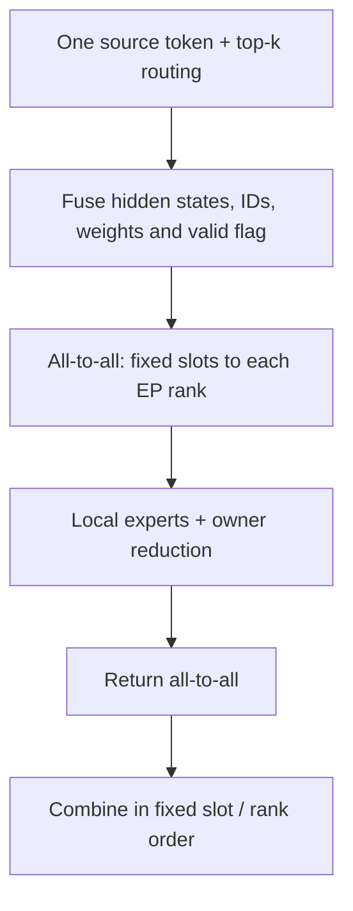

## The question

Small decode batches can spend more time preparing and moving expert inputs than doing useful GEMM work. A fixed-capacity layout removes dynamic counts exchange and host readback, but broadcasts padded rows. Can kernel fusion pay for that extra traffic?

I implemented MoEFlow as a vLLM plugin: fused dispatch pack, expert-input preparation and deterministic combine around two NCCL all-to-alls. Model loading stays with vLLM. This article interprets the [public repository snapshot](https://github.com/algebra-MCX/MoEFlow/tree/2f4968ffef7cac4f8dcf39a4a65cec55c60472f8), checked on November 22, 2026. The results below are author-recorded measurements, not a new GPU rerun for this blog.

## Follow one token

A token brings hidden states, top-k expert IDs, FP32 weights and a valid bit. Packing them into a single row avoids a separate counts exchange. Every destination receives a fixed slot for that source token; a destination evaluates only its local experts. The return exchange brings partial outputs back for deterministic combination.

Static shapes keep the path CUDA Graph capturable. The tradeoff is explicit: dispatch sends **EP × C rows**, rather than only actual routing hits. At EP4 and capacity C=1, four destination slots are reserved for one source token; this is a layout illustration, not a latency prediction. See [`fixed.py`](https://github.com/algebra-MCX/MoEFlow/blob/2f4968ffef7cac4f8dcf39a4a65cec55c60472f8/moeflow/fixed.py) and the independent [`reference.py`](https://github.com/algebra-MCX/MoEFlow/blob/2f4968ffef7cac4f8dcf39a4a65cec55c60472f8/moeflow/reference.py).

## What was measured

| Condition | Recorded setup |
| --- | --- |
| Hardware | 4 × B200, NVLink-5, EP4 |
| Layer | GLM-5.3-Flash layer 3, BF16, uniform routing |
| Timing boundary | Router logits through weighted routed-expert merge; excludes gate GEMM, shared expert, norm and residual |
| Execution | CUDA Graph replay; slowest of four ranks per sample |
| Comparison | 20 interleaved A/B repetitions; gain requires paired-difference 95% CI to exclude zero |
| Gate | Independent per-token/per-expert reference check before every point |

The repository environment lists vLLM 0.32.0, Torch 2.13 / CUDA 13, Triton 3.7.1 and NCCL 2.29.7. The README does not attach the original per-run JSON in this snapshot; those versions are the documented environment, not an independently verified inventory of each historical trial.

## Fusion helps the internal baseline

| Tokens / rank | Own unfused Torch Ring (µs) | Fused path (µs) | Reduction |
| --- | ---: | ---: | ---: |
| 1 | 249.7 | 144.2 | 42.3% |
| 8 | 574.9 | 461.7 | 19.7% |
| 128 | 873.9 | 740.8 | 15.2% |

This isolates implementation overhead against MoEFlow's own baseline. The largest relative gain occurs at the smallest batch. It does not tell us whether this execution strategy beats another backend.

## Native vLLM remains the stronger baseline

A **separate run**, with the same router and expert GEMM, compares native all-gather/reduce-scatter:

| Tokens / rank | Native vLLM (µs) | MoEFlow (µs) | MoEFlow latency change |
| --- | ---: | ---: | ---: |
| 1 | 140.9 | 146.5 | +3.9% |
| 8 | 451.3 | 464.9 | +3.0% |
| 128 | 742.3 | 752.7 | +1.4% |

MoEFlow remains 1.4–4.7% slower across all eight recorded sizes. Do not subtract points across the two independent tables. In full-model FP8 serving (1024 input / 1024 output tokens, concurrency 4), the two comparisons point in opposite directions; the native arm's TPOT itself varies by 11.6% between runs. This does not establish a stable serving speedup.

## Check the implementation, then reproduce

- [Performance tables and limitations](https://github.com/algebra-MCX/MoEFlow/blob/2f4968ffef7cac4f8dcf39a4a65cec55c60472f8/README.md#performance)
- [Interleaved total-fusion job](https://github.com/algebra-MCX/MoEFlow/blob/2f4968ffef7cac4f8dcf39a4a65cec55c60472f8/scripts/paired_total_fusion.sbatch)
- [Native-versus-fixed job](https://github.com/algebra-MCX/MoEFlow/blob/2f4968ffef7cac4f8dcf39a4a65cec55c60472f8/scripts/paired_native_fixed.sbatch)
- [Timing, statistics and validation code](https://github.com/algebra-MCX/MoEFlow/tree/2f4968ffef7cac4f8dcf39a4a65cec55c60472f8/scripts/bench)
- [Graph checks and CPU reference tests](https://github.com/algebra-MCX/MoEFlow/tree/2f4968ffef7cac4f8dcf39a4a65cec55c60472f8/tests)

The benchmark scripts are available; the raw paired samples and original environment manifests are not present in this public snapshot. Source inspection is possible, independent reproduction of the exact reported point still needs those artifacts and matching GPUs.

## Which observation would change the conclusion?

My interpretation is that fusion reduces orchestration inside the fixed-capacity backend. A comparable gain in the full server would require that work to be on the request’s critical path and not displaced by padding, communication, or another stage. Run two checks separately: first compare fused and unfused with identical input shapes and replay policy. Then compare against native vLLM while fixing request trace, model, concurrency and output lengths. Sweep uniform and skewed routes separately, and record useful versus reserved rows, per-rank timing, and end-to-end latency. If layer gains persist but server latency does not improve beyond run-to-run variance, the serving claim fails for that workload.

## What remains open

EP8, concurrent correctness, long-prefill performance and end-to-end comparison against DeepEP HT remain unvalidated. The exact-score check at 8192 tokens still fails according to the README. Future measurements should first resolve that correctness failure, preserve per-run raw JSON, and repeat the native/full-model controls before claiming a serving gain.

A useful next question is where padding, communication and preparation each enter the critical path. A fused kernel saving time is evidence about that implementation; the end-to-end policy still needs its own experiment.
