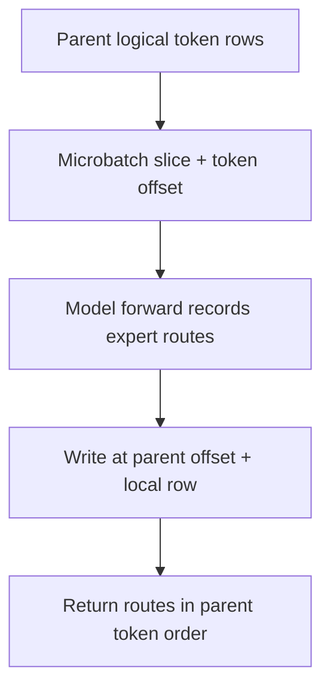

## The observable failure

In MRV2, enabling DBO and `--enable-return-routed-experts` returned corrupted expert routes. Each microbatch wrote its routes starting at row zero in the shared capture buffer. The last writer overwrote earlier rows.

I reproduced and fixed the bug in [vLLM #63372](https://github.com/vllm-project/vllm/pull/63372), merged October 25, 2026. Ronald1995 refactored the change to reuse the existing DBO token offset and added tests. This is a merged correctness contribution, not a serving speedup claim.

## Follow a row into the shared buffer

Consider a conceptual four-token parent batch split into two two-token microbatches. Local row 0 in the second microbatch belongs to parent row 2, not parent row 0.

| Microbatch | Local rows | Old destination | Correct destination |
| --- | --- | --- | --- |
| 0 | 0, 1 | 0, 1 | 0, 1 |
| 1 | 0, 1 | 0, 1 — overwrites | 2, 3 |

The fix passes `token_slice.start` into the microbatch contexts and uses `dbo_current_ubatch_token_offset()` when writing routes. Outside DBO that offset is zero. The example explains ownership; the regression test and patch establish the implementation behavior.



## Evidence and its boundary

The upstream PR records the same 32 requests, DeepSeek-V2-Lite on 2 × H200, DP2 with EP, NIXL EP and eager execution:

| Comparison with DBO-off server | Same routing |
| --- | ---: |
| DBO on, base main | 0% |
| DBO on, patched | 89.4% |
| DBO off, repeated as a noise control | 88–91% |

The agreement recovers to the repeated-run control range. It does **not** establish exact routing equality across nondeterministic model runs, and it is not a model-quality score. These measurements precede the collaborator's refactor.

The new unit test fails on base with 8/8 mismatched entries and passes after the change. The PR records 81 existing capture/ubatch tests passing on H200 before refactoring; after refactoring, the four capture cases and the overlap/single-batch and CUDA Graph replay tests were rerun successfully. Read the [patch and validation record](https://github.com/vllm-project/vllm/pull/63372/files) for the exact code and test names.

## A second fix: preserve the first recorded failure

A related debugging problem appeared when microbatch 1 failed first, then microbatch 0 hit a follow-on error. `min(errors)` picked microbatch 0 and hid the original cause. [#63476](https://github.com/vllm-project/vllm/pull/63476), also merged, selects the first recorded failure after all worker threads are joined.

On 1 × H200, base `7822663cb4` plus the new regression case produced one failure and one pass; after the fix both cases passed. The exact test command is:

```bash
VLLM_USE_V2_MODEL_RUNNER=1 pytest -q \
  "tests/v1/worker/test_gpu_ubatch_slicing.py::test_ubatch_runner_names_the_microbatch_that_failed"
```

“First recorded” means the first exception recorded in Python. CUDA errors are asynchronous, so this is not necessarily the earliest GPU fault. This change does not resolve peer-exit hangs or all HiSparse/DBO issues.

## What to inspect next

- [Merged routing fix, review and co-author credit](https://github.com/vllm-project/vllm/pull/63372)
- [Merged failure-order fix and regression evidence](https://github.com/vllm-project/vllm/pull/63476)
- [Separate decode-staging proposal](/writing/vllm-decode-staging/) — a broader layout change still under review

The common lesson is an execution contract: local microbatch position is not logical request position. Every consumer of outputs, routes, positions and failure records needs its own explicit mapping. New backends or larger microbatch counts require their own tests; these two patches do not certify all configurations.

Upstream merge status and PR text checked November 22, 2026. GPU tests were not rerun for this article.
