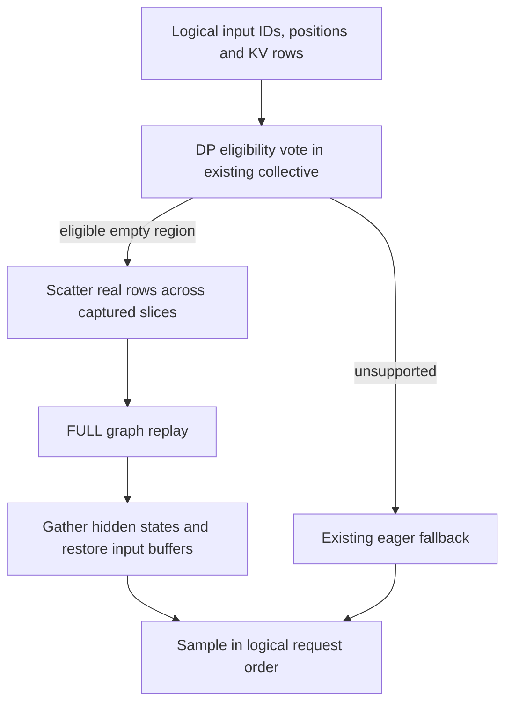

## Proposal and status

I proposed [vLLM #63556](https://github.com/vllm-project/vllm/pull/63556) to keep eligible single-token MLA decode on captured FULL microbatch graphs when uneven DP loads leave a captured region empty. The PR is open as of November 22, 2026. Earlier closed prototypes are not merged contributions.

## One concrete decode step

Take rank loads **63 and 97**, with graph bucket **128** and captured slices `[0,64)` and `[64,128)`. A contiguous 63-row rank leaves its second slice empty. The existing group policy falls back to eager execution.

Staging places 32 real rows at `[0,32)` and 31 at `[64,95)` on the smaller rank. After forward, hidden states **and input buffers** must return to logical order before sampling.

Bucket choice matters. At the default dense bucket **104**, the split is at 52 and loads 63/97 already reach both slices. The same directed example therefore does not predict activation frequency under real traffic. Loads 40/97 can still leave a region empty at bucket 104.

## The implementation contract

- Preserve token ID, position, block-table and KV-slot correspondence during scatter.
- Check capacity before any input mutation; padding KV slots remain `-1`.
- Keep graph addresses and backend metadata contracts stable.
- Restore inputs as well as outputs; restoring only hidden states is insufficient for later consumers.
- Retain eager fallback for unsupported paths.

The stated support includes default model state, NIXL EP, `FLASH_ATTN_MLA`, BF16 weights/KV, TP1 and single-token decode. Returned routes, prompt embeddings, EPLB and KV transfer retain fallback. Temporary buffers and scatter/gather/restoration writes have a cost that still needs profiling.

## Evidence should stay attached to its version

The PR reports three different kinds of evidence; they cannot be combined into a single “current version speedup”:

| Record | What it supports | What it does not establish |
| --- | --- | --- |
| Historical directed A/B | A generalized implementation replaced fallback with replay in a configured workload | Exact measured working-tree patch/hash chain and original trial directories are no longer retained |
| Earlier DP8 prototype | Execution-path and request-completion coverage | Prototype omitted input restoration and later had position-dependent sampling defects |
| Head-specific model regression (`b6660643fb`) | 160 requests/arm; expected FULL128 replay observed; repository comparator passed | 8/160 greedy sequences diverged and were accepted by a mutual-top-5 rule; not exact token/logprob equality |
| Separate ShareGPT run | 9,216 completed requests under default buckets and normal routing | Zero staging activations; no active-staging performance conclusion |

Historical timings remain in the [upstream validation section](https://github.com/vllm-project/vllm/pull/63556). Their provenance limits make them unsuitable as a headline performance claim for the current implementation. The next meaningful test is repeated paired measurement of an immutable, fully restoring implementation, with activation counts and a declared output-comparison rule.

## What would change the conclusion?

A workload where staging rarely activates weakens its serving relevance. A failure in position-sensitive sampling invalidates an otherwise fast path. Repeated trials that include restoration costs could shrink the gain. These are testable objections, not details to hide behind one throughput number.

Start with the [current patch](https://github.com/vllm-project/vllm/pull/63556/files), the regression test and the support matrix. The separate [merged row-ownership fixes](/writing/vllm-dbo-correctness/) address narrower correctness bugs and do not certify this proposal.
